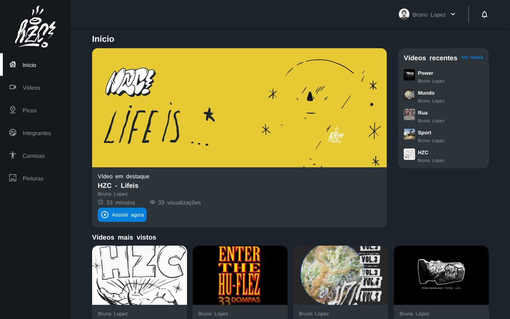

# HZC — layout com Flexbox e Grid

[](https://github.com/almircs/Flex-e-Grid/actions/workflows/ci.yml)

Página inicial de uma plataforma de vídeos, construída a partir de um layout do Figma no curso de Flexbox e CSS Grid da Alura. A mesma página muda de organização entre celular e desktop sem duplicar o HTML.

**[▶ Ver a página](https://almircs.github.io/Flex-e-Grid/)**



## Destaques

- **CSS Grid** para a estrutura geral da página e para as áreas de conteúdo
- **Flexbox** para alinhar itens dentro de cabeçalho, cartões e listas
- **Mobile first**: menu lateral que abre e fecha no celular e fica fixo no desktop
- Nomes de classe no padrão **BEM** (`cartao__titulo`, `menu-lateral--ativo`)
- Ícones vindos de uma fonte (`icones.ttf`) aplicados com pseudo-elementos
- Menu acessível: fecha com `Esc` ou clicando fora e informa o estado a leitores de tela

As cores, espaçamentos e códigos dos ícones usados estão no [guia de estilos](docs/guia-de-estilos.md), e o layout original está no [Figma](https://www.figma.com/file/ibWktwVpnog76rMYOdVhks/Dispondo-elementos-com-flexbox-e-grid?node-id=54%3A2358).

## Rodar localmente

```bash
git clone https://github.com/almircs/Flex-e-Grid.git
```

Depois é só abrir o `index.html` no navegador.

## Licença

[MIT](LICENSE)
